# MarginPilot v1.1.1

[English guide](README.md) · [简体中文使用说明](README.zh-CN.md)

A simple, offline profit assistant for neighborhood shops and family-run businesses. Answer three practical questions: **How much did I earn? Where did my money go? What should I improve?**

The app has complete Simplified Chinese and English interfaces. The original sidebar, restrained green palette, headline figures, charts, and modular React architecture remain. All money is **Chinese yuan (CNY)** in either language; switching language does not convert currency.

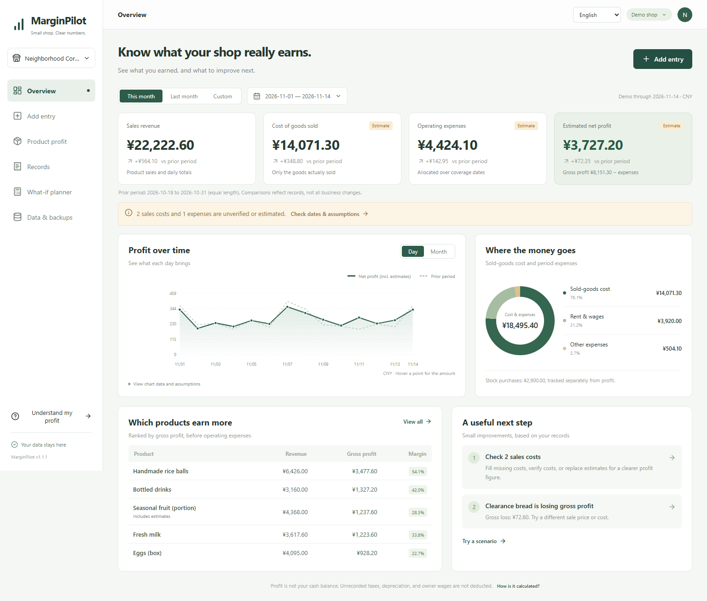

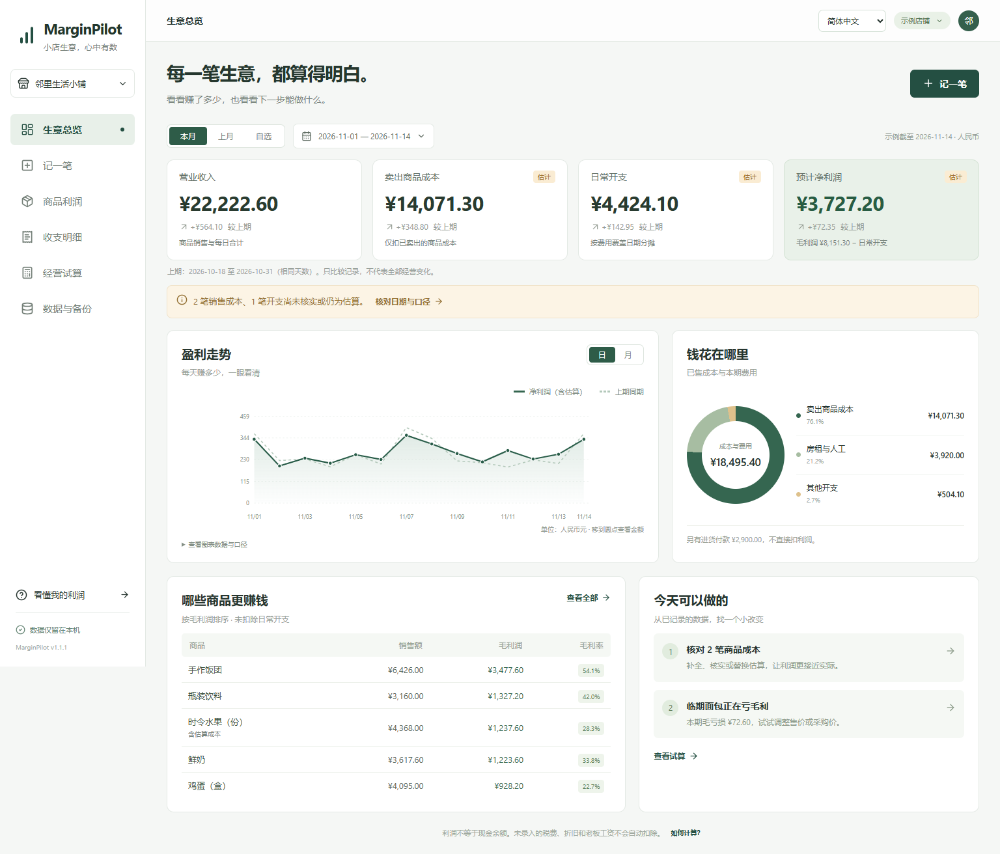

## Open it without installing anything

1. Download `MarginPilot-v1.1.1.zip` and choose **Extract All**.
2. Keep the extracted folder in a stable location. Double-click **MarginPilot.html**. In the source checkout, it is in `release/`.
3. On the welcome screen, select **English** or **简体中文** in the visible language menu.
4. Choose **Explore the demo** to try realistic records, or **Open my real business** for an empty book. These books stay separate. You can switch later from the shop selector or Data & backups.

**Success:** a dashboard opens with the correct Demo shop / Real business label. No terminal, account, server, internet connection, Excel installation, or API key is needed. Chrome and Microsoft Edge were tested.

The language menu also appears in dialogs. Switching language preserves records, amounts, checked dates, product names, notes, selected entries, and unfinished form values. Your own text is never automatically translated. Demo products have bilingual labels. Your last language and book are remembered when browser storage is available.

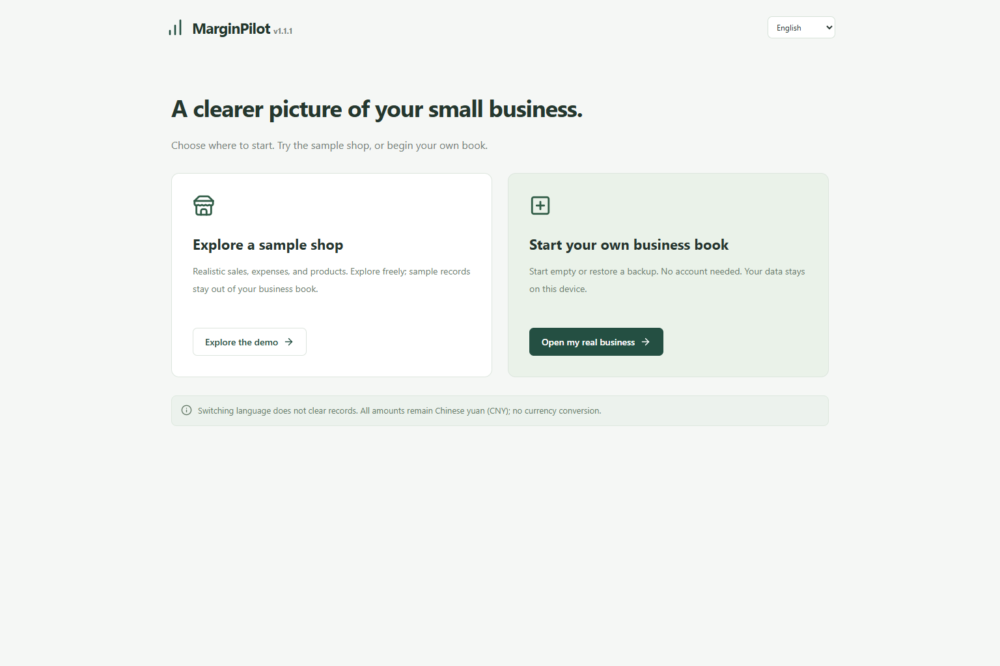

## Upgrade from v1.0 or v1.1 safely

1. Open your existing v1.0 or v1.1 app and download a **JSON backup** from **数据与备份 → 下载备份**. Keep the old app and backup.
2. Open v1.1.1. Choose **Open my real business → Data & backups → Choose backup**.
3. Select the old JSON file. Review the shop and record counts, then choose **Replace current book**. You can download the current book before replacement.
4. Review the imported records and check the relevant dates again.

**Success:** products, sales, expenses, purchases, user notes, and amounts are preserved. Old checked dates are cleared because v1.0 could retain stale confirmations. This does not change financial records.

v1.1.1 uses the same local storage keys as v1.1 and reads v1.0 storage as a fallback. When the browser/file origin stays the same, existing v1.1 records load unchanged. Moving the HTML or changing browsers can hide that storage, so JSON backup and restore is the reliable upgrade path. Keep the pre-upgrade backup and original app. The original v1.0 and v1.1 ZIPs remain in the workspace.

v1.1.1 reads v1.0 (schema 1) and v1.1 (schema 2) backups, and keeps schema 2 with an additional `unverified` status. New backups containing this status cannot be opened by older versions; use your pre-upgrade backup to roll back. Every restore clears checked dates while preserving financial records.

**Existing import statuses are not rewritten automatically.** Older versions did not record whether Verified came from an explicit choice or a blank cell. Review previously imported costs and expenses against their source; edit uncertain entries to Unverified. Reimporting an old blank-status file with the same IDs may report a status conflict. This prevents silent changes to old records; review and edit those originals instead.

## What changed in v1.1.1

- Empty import status becomes **Unverified**, visible in preview, records, and exports. Checking dates does not verify amounts.
- Products used only by excluded import rows are not added. Existing products and shared products used by an included row are retained.
- Whole-shop monthly scenarios join the existing product planner, without changing records.
- Quick entry starts with revenue only. Missing costs can be added later to the same record.
- Both languages, offline operation, the design, and the existing modular architecture are retained.

## Record a day quickly

1. Choose **Add entry → Quick daily entry**.
2. Enter the date and the whole day's **Daily sales revenue**. Use sales after discounts and excluding tax collected on behalf of government.
3. Leave **Add costs later** selected if you do not know the cost. Choose **Save entry** with just the date and revenue. Full profit stays **Incomplete**; unknown cost is never zero.
4. If you know the cost, choose **Enter costs now**. Enter only the cost of goods actually sold, **not stock purchase payments**. Choose **Verified** for checked figures, **Estimated** for a deliberate estimate, or **Unverified** for an amount that still needs checking.
5. Later, open **Records → Daily sales total → Add cost**. Enter the cost, choose its status, and save the existing record. Do not add that day's revenue again. A changed cost requires the date to be checked again.

**Success:** a saved message appears. The daily total appears under **Records → Daily sales total**, and the dashboard recalculates.

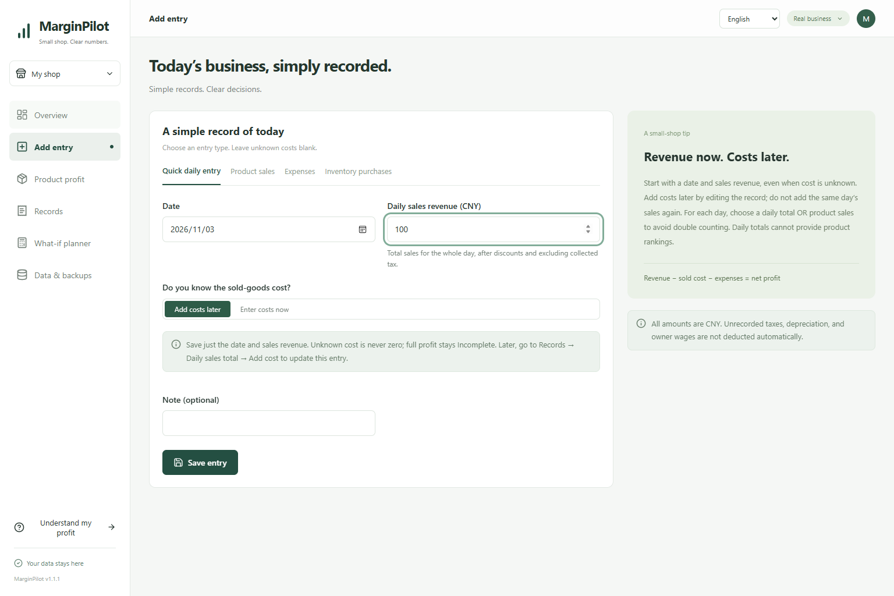

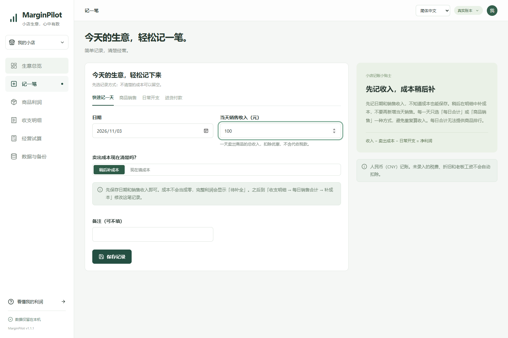

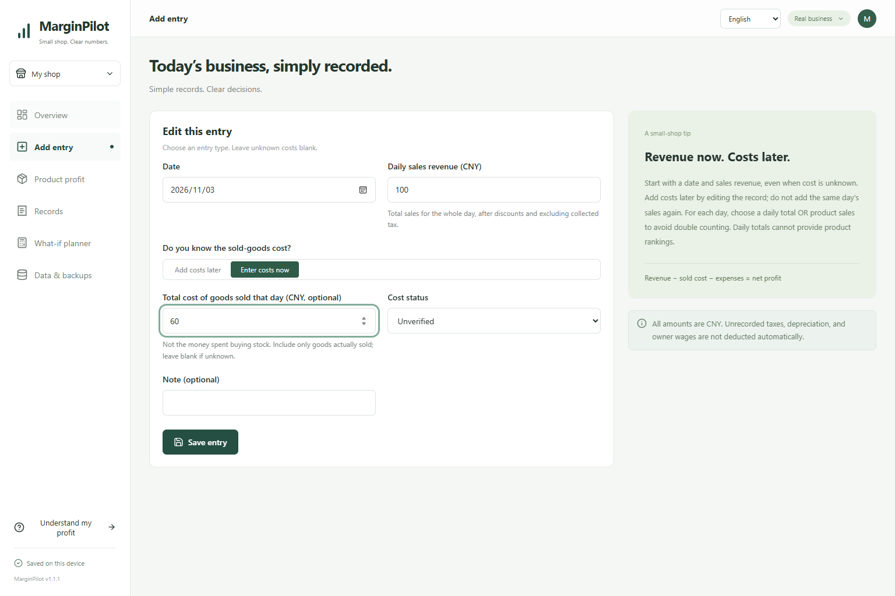

Use **one daily total OR product-level sales for each day**. The app blocks two daily totals on one day and blocks mixing a daily total with product sales on the same date. To change methods, first edit/delete the original records in Records, then enter the replacement. Daily totals are included in revenue, sold-goods cost, profit, and charts, but excluded from product rankings and product scenarios.

## Keep product detail when it is useful

1. Choose **Add entry → Product sales → Add product**. Give it a name and usual price; reference cost is optional.
2. Choose the date and product. Enter whole-item quantity, actual price, and the cost of the units sold.
3. Mark cost as Verified or Estimated, then save. A blank sale cost uses the product's reference cost as an explicit estimate. Without either, full profit stays incomplete.
4. Use separate rows for different prices or costs. Identical real transactions may be recorded separately.

**Success:** records appear in Records → Product sales and contribute to Product profit. Editing reference cost affects only estimates that use it, never recorded actual costs. Affected dates need a fresh check.

Quantities are whole items/portions, not fractional weights. Use consistent portion units. The app does not manage inventory batches or automatically calculate FIFO/weighted-average purchase costs.

## Enter everyday expenses

1. Choose **Add entry → Expenses**, a date, category, total amount, and amount status.
2. Choose **This day** for a one-off expense. Both coverage dates become the entry date.
3. Choose **Whole month** for rent, wages, or utilities. The month containing the entry date is selected automatically, including leap-year February.
4. Use **Custom dates** if the cost covers another period. Save.

**Success:** the full expense is in Records → Expenses. The dashboard deducts only the portion allocated to the selected dates. Changing the entry date updates coverage while a daily/monthly preset is active. Manually editing coverage switches to custom dates.

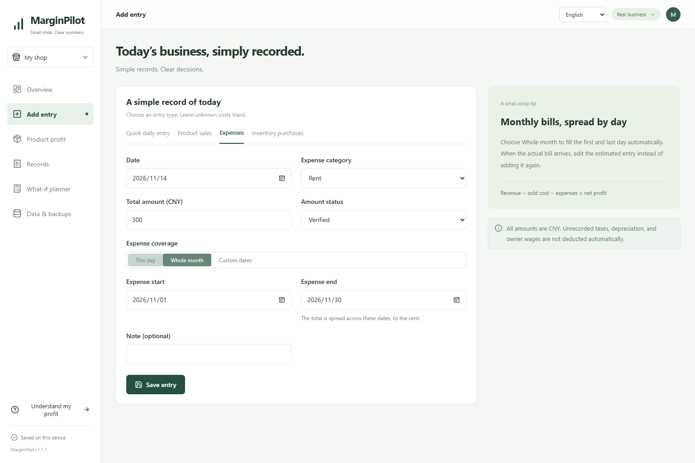

Amounts are stored as integer cents. An expense of ¥100.01 covering three days allocates ¥33.34, ¥33.34, and ¥33.33. The few remaining cents go to the earliest days, so daily amounts reconcile exactly with the period total. When an actual bill arrives, **edit the estimated entry instead of adding it again**.

Use **Inventory purchases** for stock payments. They are visible separately and do not directly reduce profit. Sold-goods cost must be recorded in the corresponding product sales or daily total.

## Read and check your profit

| Figure | Meaning |
|---|---|
| Sales revenue | Product quantity × actual price, plus daily revenue totals on other dates |
| Cost of goods sold | Costs of sold units, plus daily sold-cost totals; not unsold stock purchases |
| Gross profit | Revenue minus sold-goods cost |
| Operating expenses | Expense amounts allocated to the selected dates |
| Net profit | Gross profit minus allocated operating expenses |

Example: buy 100 drinks for ¥3 each, sell 20 for ¥5, and incur ¥15 in daily expenses. Revenue is **¥100**, sold cost **¥60**, gross profit **¥40**, and net profit **¥25**. The **¥300 stock payment** is separate. It is not deducted a second time.

- **Recorded net profit:** costs and expenses are verified and all selected dates have been checked. It still depends on complete, accurate input.
- **Estimated net profit:** reference/estimated costs, unverified amounts, estimated bills, or unchecked dates remain. The dashboard explains what is uncertain.
- **Incomplete:** at least one sales cost is unknown with no usable reference. Full gross/net profit is withheld; missing costs are never zero. Deliberately entered zero cost remains valid.
- **Verified portion only:** the check dialog shows the difference for sales with verified costs and verified expenses. It excludes unverified portions and is not full profit.

1. Review sales and expenses for the selected period, including closed days.
2. Choose **Check dates & assumptions** and confirm that you checked every day.
3. Choose **Mark dates checked**.

**Success:** those dates are checked. Unverified amounts and estimates remain so until you check the sources and edit each entry’s status to Verified. Checking dates only confirms completeness. Even zero-cost or zero-amount entries require the correct status. Any later record change invalidates the relevant checked dates automatically:

| Change | Dates requiring a new check |
|---|---|
| Add, edit, delete, import, or undo a sale/daily total/purchase | Affected record dates; moving a record invalidates both old and new dates |
| Change an expense | Union of its old and new coverage dates |
| Change a product reference cost | Dates of sales using that reference estimate |
| Restore a backup | All dates |
| Switch language or rename a shop | No financial dates are invalidated |

Profit is not cash balance. Tax expenses, depreciation, owner wages, losses, refunds, and financing are not inferred. Enter applicable costs yourself. For refunds, correct/split original sales; record spoilage as an expense. This is a management assistant, not statutory accounts or tax software.

## Import CSV or Excel without losing legitimate transactions

1. Open **Data & backups → Download template in this language**. The ZIP also includes `samples/template-en.csv`, `template-zh.csv`, and both `.xlsx` versions.
2. Keep the headers and use `YYYY-MM-DD` dates. Both language templates are accepted regardless of the current interface language.
3. Use **Sale**, **Expense**, **Purchase**, or **Daily total**. Chinese equivalents are **销售、开支、进货、每日合计**.
4. Fill **Transaction ID** if your source provides a stable identifier. Prefix IDs with their source, e.g. `till-A-001`, so different tills do not collide. The column is optional.
5. Choose the file. Review **all rows** in the scrollable preview, including quantity, price, cost, note, ID, and possible-duplicate flags. Uncheck any rows you do not want.
6. Fix every error before importing. If possible duplicates exist, acknowledge that the checked rows are real new entries. Confirm import.

**Success:** only the selected rows and their necessary new products are saved. Products used only by excluded rows are not added; existing products are retained. Totals update, and affected dates need rechecking. You can undo while the message is visible.

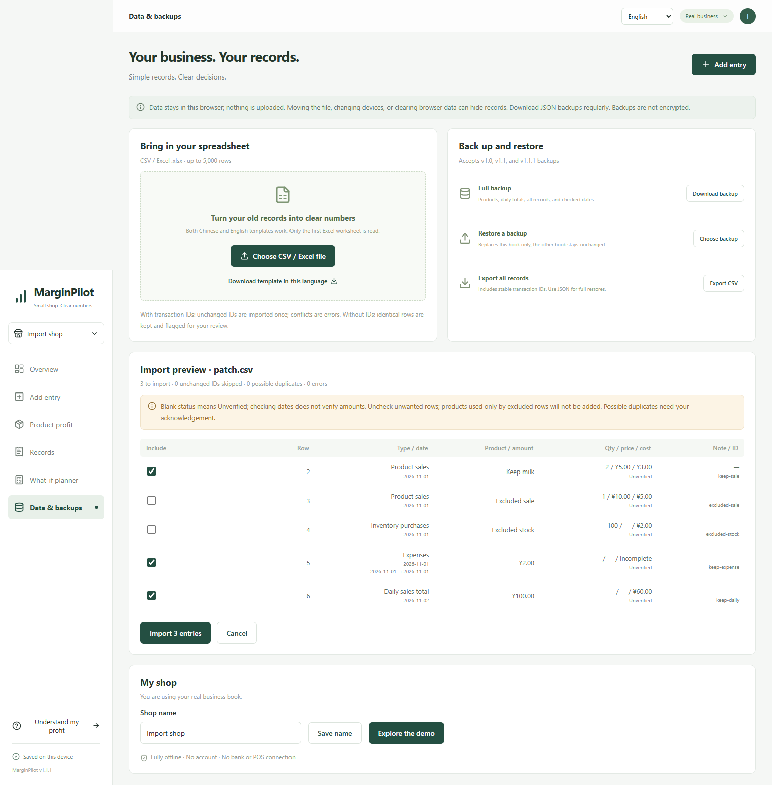

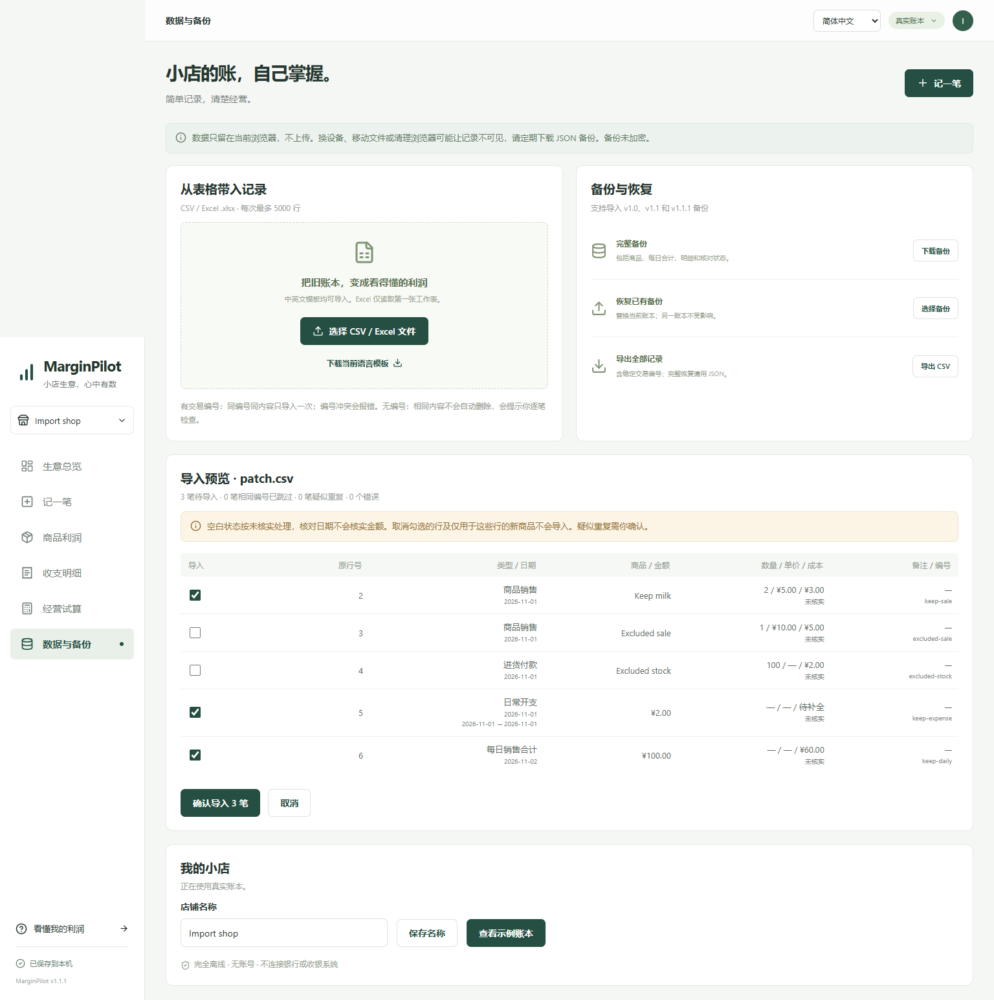

| Situation | v1.1.1 behavior |
|---|---|
| Same contents, different transaction IDs | Both are retained |
| Identical rows without IDs | Retained by default, flagged for review; never silently discarded |
| Same ID, same contents | Reported as already imported and skipped |
| Same ID, different contents | Error; edit the original record or use a new ID |
| A repeated daily total or daily/product overlap | Error to prevent double-counting whole-day revenue |

IDs are scoped to the entire book. Contents include notes, dates, amounts, cost/status, and expense coverage. Exported CSV contains stable IDs so unchanged exports can be safely reimported. Reimporting an original file **without IDs** is not automatically idempotent: review its possible duplicates carefully. Every included row is a new transaction. A note difference alone does not prove a transaction is new.

| English column | Chinese column | Use |
|---|---|---|
| Type / Date | 类型 / 日期 | Required for every row |
| Product / Quantity / Unit price | 商品 / 数量 / 单价 | Product sales; quantity is a positive whole number |
| Unit cost | 单位成本 | Cost per sold/purchased unit; required for purchases |
| Amount | 金额 | Expense amount or whole-day revenue |
| Category | 类别 | Expense category; standard categories work in either language |
| Expense start / Expense end | 费用开始 / 费用结束 | Coverage dates; default to Date |
| Status | 状态 | Unverified / Verified / Estimated, or 未核实 / 已核实 / 估算; blank or omitted defaults to Unverified |
| Note / Transaction ID | 备注 / 交易编号 | Optional user note and stable source identifier |
| Total sold cost | 卖出商品总成本 | Daily total only; blank remains missing, not zero |

Limits: 5 MB input; 5,000 rows; 20 MB uncompressed XLSX; first worksheet only; UTF-8 CSV. Excel's normal 1900-system numeric dates are supported. Paste formulas as values first. Old `.xls`, password-protected workbooks, and the 1904 date system are unsupported and report an error. All parsing stays on-device; no spreadsheet formula or macro is executed. CSV export uses a UTF-8 BOM and protects formula-like text. Use JSON for exact full-book backups, including identity, products, user text, and daily totals.

## Trends, suggestions, and scenarios

Choose This month, Last month, or Custom (up to 366 days). The daily chart compares with the immediately preceding equal-length period. Month shows six calendar months ending on the selected end date; the last month can be partial. Expand **View chart data and assumptions** for exact values. Missing costs appear as gaps; a zero on an unchecked day does not prove there was no trading.

Product profit shows contribution before rent/wages. Suggestions identify missing or unverified costs, dates needing review, loss-making products, and strong contributors.

### Try a whole-shop monthly plan

1. Open **What-if planner → Whole-shop monthly plan** and choose a calendar month. This month selector controls the monthly scenario; the top date range still controls product scenarios.
2. Enter the **new total monthly rent**, or leave blank to keep the allocated rent already recorded.
3. Enter a **purchasing cost change** from −100% to +100%. For example, `-5` means goods are 5% cheaper. This changes only the cost of goods sold, including daily totals. Unsold inventory payments never become an extra profit deduction.
4. Enter the **new total monthly other expenses**, excluding rent, or leave blank to keep the recorded amount. Enter `0` explicitly to remove an expense in the scenario.
5. Compare the original and scenario profit, then use **Reset scenario** to restore the original assumptions.

**Success:** figures change immediately, while the book remains unchanged. For example, monthly revenue ¥10,000, sold cost ¥6,000, rent ¥1,000, and other expenses ¥500 yield ¥2,500 profit. Reducing rent to ¥800, sold costs by 10%, and other expenses to ¥400 yields **¥3,400**, an improvement of **¥900**.

The baseline uses that calendar month's recorded sales and allocated expenses. It does **not extrapolate** a few recorded days into a full month's trading. Unchecked days or uncertain amounts are labelled; missing costs withhold full scenario profit. Revenue and sales volume stay fixed. New expense totals replace the originals instead of being added to them. All scenario results are estimates, not forecasts or earnings promises.

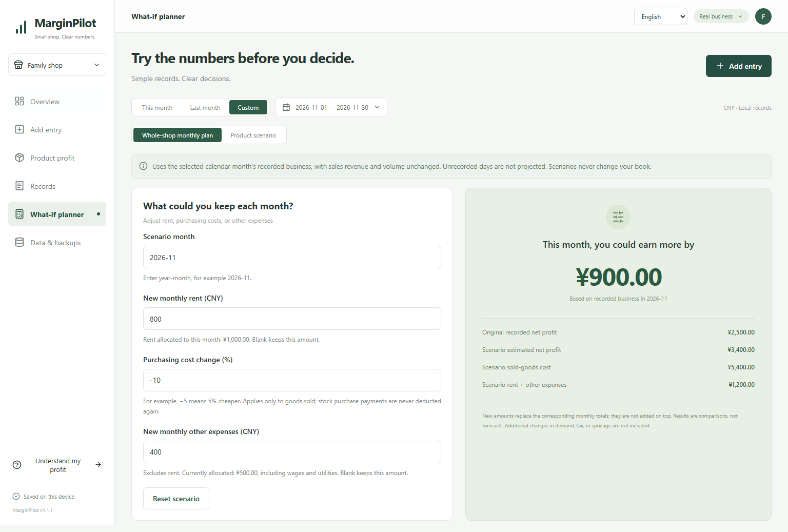

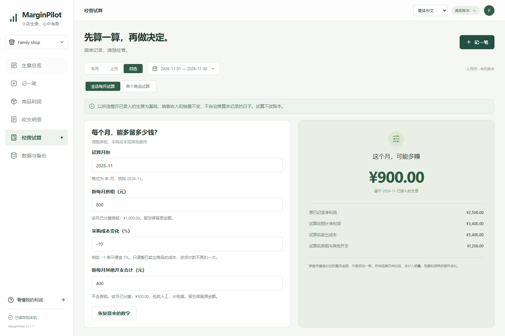

### Keep using product scenarios

Choose **Product scenario** to adjust a product's price, unit cost, and volume. Other expenses stay fixed. Quantities round to whole items. Untouched inputs retain exact weighted averages, so an unchanged scenario has zero impact. Daily totals remain excluded from product rankings and product scenarios.

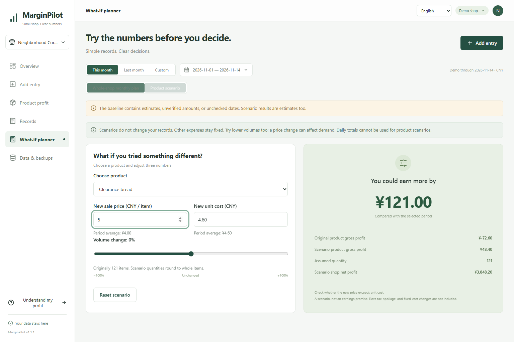

## Correct records, back up, and recover

Use the pencil in Records to edit. Use the trash button and confirm to delete. Undo is available for 15 seconds after delete/import/restore, until another save replaces it. Undo restores records but does not resurrect stale checked dates.

Download JSON backups regularly from Data & backups. Backups are unencrypted; keep them somewhere safe. Restoring replaces only the currently selected demo/real book after review. A failed save leaves the form intact and does not show a success message. Another-window writes are detected and blocked to avoid overwriting. If saved data is corrupt, writes pause and **Export raw data** is offered; explicit backup restore can recover the book.

Browser storage is not durable backup. Clearing data, private browsing, changing browsers/devices, or moving the HTML may make records unavailable. There is no multi-device sync or multi-user accounting server; edit in one tab at a time.

## Verification and development

The retained functional reference is [Loyverse Back Office](https://loyverse.com/en-us/back-office): simple navigation, date filters, charts, item reports, and spreadsheet workflows. MarginPilot remains deliberately smaller than a POS or enterprise accounting platform.

The code remains split into accounting, imports, sample data, forms, reports, charts, data management, and the app shell. v1.1 adds explicit bilingual strings in `i18n.mjs` and a central save/invalidation path in `storage.mjs` and `core.mjs`. There are no new runtime dependencies, network requests, external fonts, or hosted services. The single-file build blocks network connections using its content security policy.

Validation includes 54 accounting/import/storage/scenario checks and both-language offline browser workflows: onboarding, draft-preserving language switches, all entry types, daily/monthly expenses, chart filters, rankings/scenarios, verification/rechecking, edit/delete/undo, CSV and XLSX, ID collisions and no-ID duplicates, per-row exclusion, v1.0/v1.1/v1.1.1 backup restore, export, persistence, invalid inputs, corrupted-storage recovery, and simulated failed/concurrent writes. New patch checks cover empty/whitespace statuses, verified-portion exclusion, zero amounts, product exclusion and shared products, revenue-first entry and later costs, calendar-month simulations, invalid assumptions, and schema compatibility. English screens are checked for untranslated interface text; user-entered text is preserved. Desktop 1536×1024 and mobile 390×844 screenshots were inspected for clipping and overflow.

Playwright uses installed Chrome and Edge. The Browser plugin/skill is unavailable in this session, and the previous in-app browser connection timed out. Test downloads require ordinary local execution permission because the restricted Windows process sandbox cancels them. Tests use isolated profiles and synthetic data. No real shop records are read or changed. No browser security settings are disabled. Safari/Firefox, assistive-technology certification, large long-term production datasets, and real tax/accounting workflows are not certified.

Developer-only commands (shop owners do not need them): `npm install`, `npm test`, `npm run build`, `npm run test:ui`, `node tests/edge-cases.mjs`, `node tests/v111-ui.mjs`, `node scripts/samples.mjs`, `npm run package`. Node.js 20+ is required for development. Use `BROWSER_CHANNEL=msedge` for Edge. The package includes the tested standalone HTML, source, both guides, screenshots, import examples, and original third-party license notices.

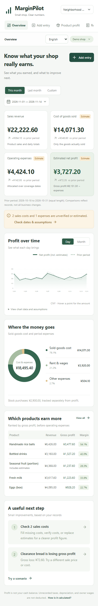
