# MarginPilot v1.1.1

[English guide](README.md) · [简体中文使用说明](README.zh-CN.md)

一个给社区小店、夫妻店和家庭生意使用的离线利润助手，帮助回答：**赚了多少钱？钱花到哪里去了？接下来改进什么？**

支持完整的简体中文和英文界面，保留原有侧边导航、克制的绿色配色、大号数字、图表和模块化架构。两种语言均使用**人民币（CNY）**；切换语言不会换汇。

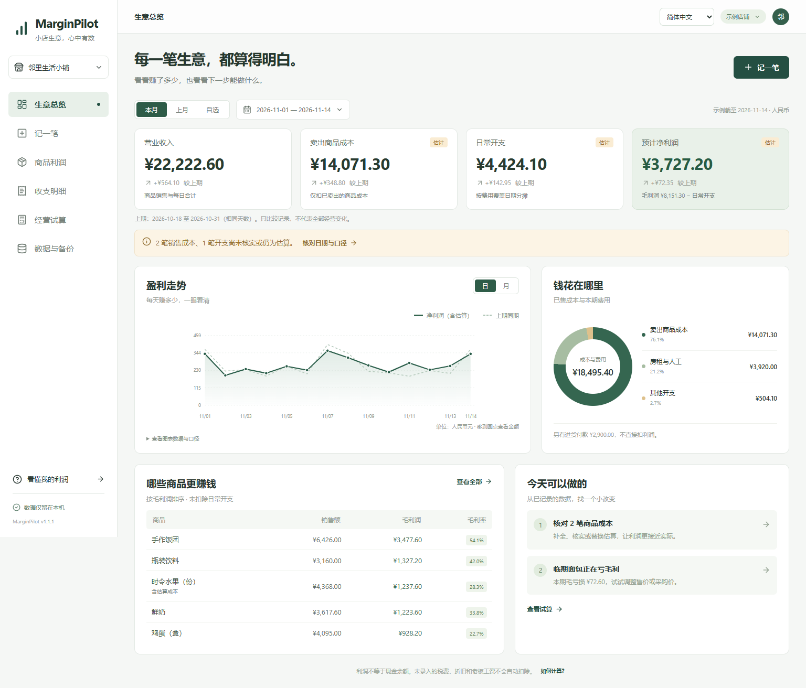

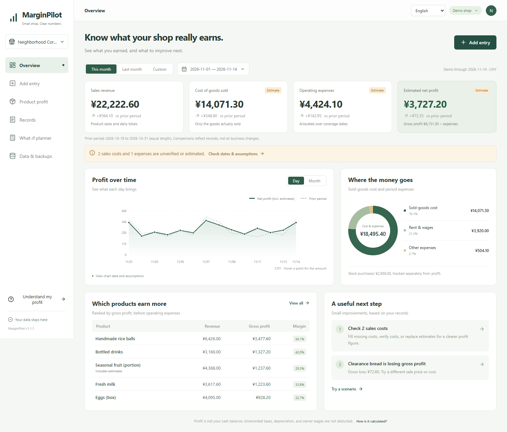

## 无需安装，直接打开

1. 下载 `MarginPilot-v1.1.1.zip`，右键选择“全部解压”。
2. 把解压后的文件夹放在固定位置，双击 **MarginPilot.html**。源代码目录中的文件位于 `release/`。
3. 在欢迎页右上角选择 **简体中文** 或 **English**。
4. 选择“体验示例店铺”了解功能，或选择“打开真实账本”从空账本开始。两个账本完全分开，以后可通过店铺选择器或“数据与备份”切换。

**成功标志：**看到总览页，以及正确的“示例店铺”或“真实账本”标识。不需要终端命令、账号、服务器、网络、Excel 或 API 密钥。已测试 Chrome 和 Microsoft Edge。

弹窗内也有语言选择器。切换语言保留记录、金额、核对状态、商品名、备注、选择项以及未保存的表单内容。用户输入的文字不会自动翻译；示例商品自带双语名称。浏览器允许存储时，会记住上次的语言和账本。

## 从 v1.0 或 v1.1 安全升级

1. 打开原 v1.0 或 v1.1，进入“数据与备份 → 下载备份”，保存 **JSON 备份**。保留旧应用和备份文件。
2. 打开 v1.1.1，选择“打开真实账本 → 数据与备份 → 选择备份”。
3. 选择旧版 JSON，核对店名和记录数量，再点“确认替换当前账本”。替换前也可下载当前账本备份。
4. 检查恢复的记录，并重新核对相关日期。

**成功标志：**商品、销售、费用、进货、用户备注和金额保持不变；旧核对状态被清除。这是因为 v1.0 可能保留已经过期的核对标记，并不表示金额被改动。

v1.1.1 沿用 v1.1 的本机存储位置，也能读取 v1.0 旧存储。同一浏览器及文件来源下，已有 v1.1 记录原样加载；移动 HTML 或换浏览器可能无法发现记录，所以 JSON 备份恢复最可靠。请保留升级前备份和旧应用；工作区原 v1.0 和 v1.1 ZIP 均保留。

v1.1.1 能读取 v1.0（结构版本 1）和 v1.1（结构版本 2）备份，继续使用结构版本 2，并新增 `unverified` 状态。含新状态的备份不能交给旧版打开；回退请用升级前备份。恢复任何版本都会清除日期核对状态，但保留财务记录。

**不会自动重写历史导入的核实状态。**旧版没有记录“已核实”来自主动选择还是空白单元格，因此无法可靠区分。请对照来源检查旧导入的成本与费用，将不确定的记录改为“未核实”。原空白状态文件再次使用相同编号导入时，可能提示状态冲突，这是为了避免静默改动旧记录；请核查并编辑原记录。

## v1.1.1 修复了什么

- 导入状态空白时按“未核实”保存，并显示在预览、明细和导出中。核对日期不会核实金额。
- 只用于被排除行的新商品不会加入商品列表；已有商品和仍被选中行引用的共用商品保留。
- 新增全店每月试算，保留单个商品试算，不修改账本。
- 快速记一天默认先记收入，可稍后在原记录中补成本。
- 保留双语、离线使用、整体设计和原有模块架构。

## 快速记一天

1. 点“记一笔 → 快速记一天”。
2. 填日期与当天整天的销售收入，使用优惠后、不含代收税款的金额。
3. 不清楚成本时保持“稍后补成本”，只填日期和收入即可保存。完整利润显示“待补全”，未知成本不会当成零。
4. 已有成本时选“现在填成本”，只填写**已经卖出的商品成本，不是进货付款**。已检查依据的选“已核实”，有意估计的选“估算”，已有金额但还未检查的选“未核实”。
5. 以后在“收支明细 → 每日销售合计”点“补成本”，填写成本和核实状态，保存原记录，不要重复新增当天收入。成本改动后，相关日期需要重新核对。

**成功标志：**出现保存提示，“收支明细 → 每日销售合计”能找到记录，总览重新计算。

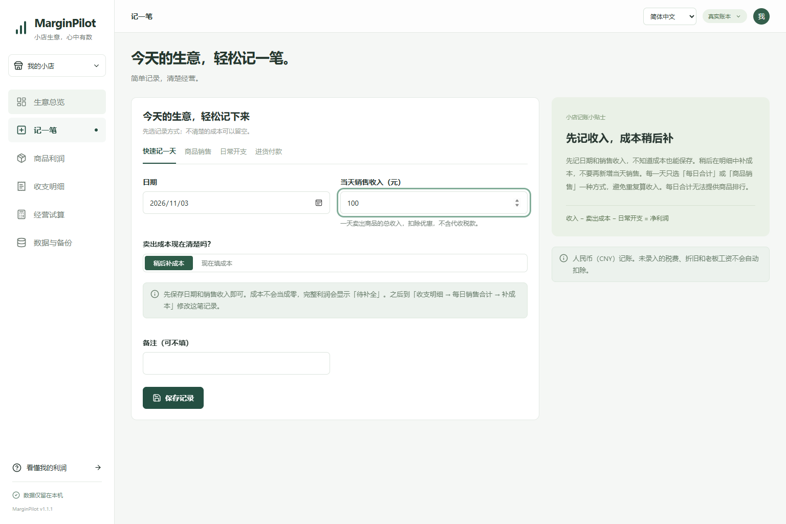

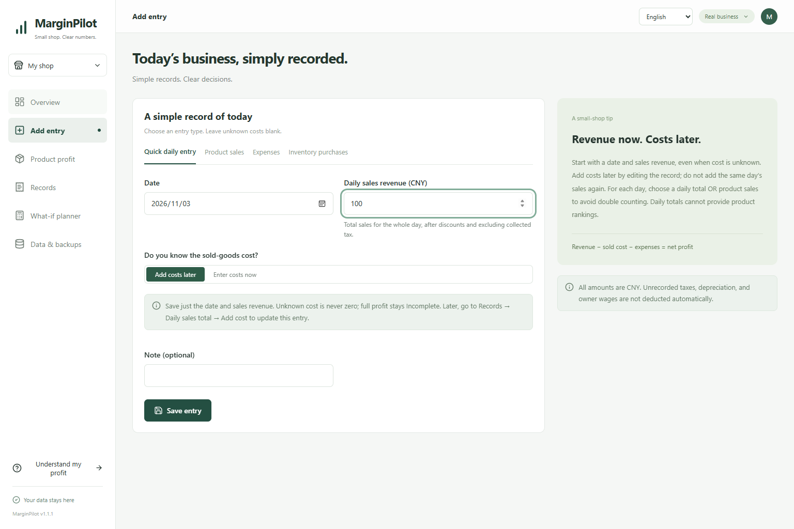

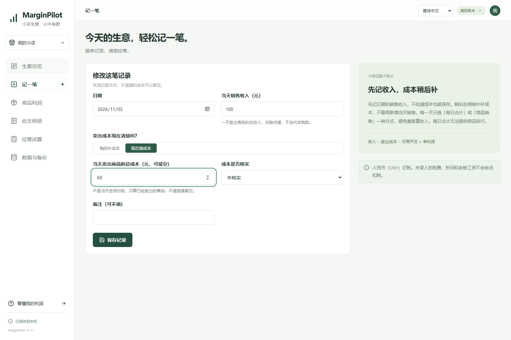

同一天只能使用“一笔每日合计”或“商品销售明细”中的一种。应用会阻止一天重复记两笔合计，也会阻止合计和商品明细混记，避免收入重复计算。要更换方式，请先在明细中修改或删除原记录，再录入替代记录。每日合计参与收入、卖出成本、利润和趋势图，但不参与商品排行或商品试算。

## 需要时，保留商品明细

1. 点“记一笔 → 商品销售 → 添加商品”，填写商品名和平时售价，参考成本可不填。
2. 选择日期和商品，填写整件或整份数量、实际售价、这批卖出商品的单位成本。
3. 选择成本是否核实，然后保存。实际成本留空时，会把商品参考成本明确作为估算；两者都没有时，完整利润显示待补全。
4. 售价或成本不同要分笔。确实发生的相同交易可以分别记录。

**成功标志：**在“收支明细 → 商品销售”找到记录，并在“商品利润”看到贡献。修改参考成本只影响使用该参考值的估算，不改写已记录的实际成本；涉及日期需要重新核对。

数量只支持整件、整份，不支持小数重量，请使用一致的份量单位。应用不会自动管理库存批次、先进先出或加权平均进货成本。

## 日常费用更容易记

1. 点“记一笔 → 日常开支”，填写记账日期、类别、整笔总金额和核实状态。
2. 单次开支选“只算当天”，费用开始和结束日期都自动设为当天。
3. 房租、人工、水电等可选“整个月”，自动填好记账日期所在月份的首尾日期，包括闰年二月。
4. 其他覆盖范围选“自己选日期”，填写后保存。

**成功标志：**明细显示整笔开支；总览只扣所选期间分摊到的部分。使用日或月预设时，更改记账日期会同步更新覆盖范围；手动修改覆盖日期则切换为自选。

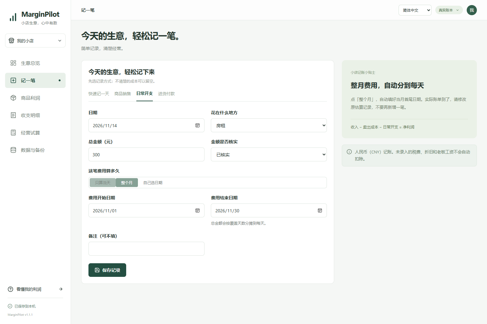

金额按整数“分”计算。100.01 元覆盖三天时，分别分摊 33.34、33.34 和 33.33 元；除不尽的几分钱分给最前面的日期，保证每日金额与总额完全一致。实际账单到了，**修改原估算记录，不要再新增一笔**。

“进货付款”单独记录库存采购现金支出，不直接扣除利润。商品真正卖出时，再通过商品销售或每日合计填写已售成本。

## 看懂利润，并完成核对

| 数字 | 计算含义 |
|---|---|
| 营业收入 | 商品销售数量 × 实际单价，加上其他日期的每日销售合计 |
| 卖出商品成本 | 已售数量对应成本，加上每日已售总成本；不包含未售库存采购 |
| 毛利润 | 收入减去卖出商品成本 |
| 日常开支 | 各费用在所选日期内分摊的金额 |
| 净利润 | 毛利润减去本期日常开支 |

例如进货 100 瓶饮料，单位成本 3 元，卖出 20 瓶，每瓶 5 元，当天费用 15 元。收入 **100 元**，卖出成本 **60 元**，毛利润 **40 元**，净利润 **25 元**。**300 元进货付款**单独显示，不再重复扣一遍。

- **已记录净利润：**选定日期全部核对过，成本和费用均已核实。准确性仍取决于录入是否完整、正确。
- **预计净利润：**存在参考成本、未核实金额、估算账单或待核对日期。总览会说明不确定的信息。
- **待补全：**至少一笔销售缺成本且无参考值，不计算完整毛利润和净利润。未知不等于零；明确填写的零成本仍有效。
- **已核实部分收支差额：**核对弹窗只统计已核实成本的销售和已核实费用，不包含未核实部分，不是完整利润。

1. 检查所选期间的销售和费用，也确认未营业日期。
2. 点“核对日期与口径”，勾选已逐日检查。
3. 点“标记已核对”。

**成功标志：**这些日期被标为已核对。未核实与估算金额不会自动变为已核实；请检查来源并编辑每笔记录的状态。核对日期只确认是否记全，即使金额或成本为零，也要保留正确的核实状态。后来修改记录会自动让相关日期重新待核对：

| 操作 | 哪些日期重新核对 |
|---|---|
| 新增、修改、删除、导入或撤销销售、每日合计、进货 | 涉及的记录日期；更改日期同时影响新旧日期 |
| 修改费用 | 新旧覆盖日期范围的并集 |
| 修改商品参考成本 | 使用该参考成本的销售日期 |
| 恢复备份 | 全部日期 |
| 切换语言或只改店名 | 不影响财务核对状态 |

利润不等于现金余额。税费、折旧、老板工资、损耗、退款和融资不会自动推算。请自行录入适用成本；退款修改或拆分原销售，报损记录为损耗费用。本工具辅助经营，不生成法定财报或报税结果。

## 导入表格，不误删真实的相同交易

1. 进入“数据与备份 → 下载当前语言模板”。下载包也有 `samples/template-zh.csv`、`template-en.csv` 和两种语言的 `.xlsx`。
2. 保留表头，日期用 `YYYY-MM-DD`。不论当前界面语言，都能导入中英文模板。
3. 类型填写“销售、开支、进货、每日合计”；英文为 `Sale / Expense / Purchase / Daily total`。
4. 来源系统有稳定编号时，填写“交易编号”。建议带来源前缀，如 `till-A-001`，避免不同收银机编号碰撞。此列可留空。
5. 选择文件，在可滚动预览中逐行查看数量、单价、成本、备注、编号及疑似重复标记；不需要的行取消勾选。
6. 先修正所有错误。存在疑似重复时，确认勾选的行都是要新增的真实记录，再确认导入。

**成功标志：**只有被选中的记录及其需要的新商品会保存；只被排除行引用的新商品不会加入，已有商品保留。总览更新，涉及日期需要重新核对。提示显示期间可以撤销。

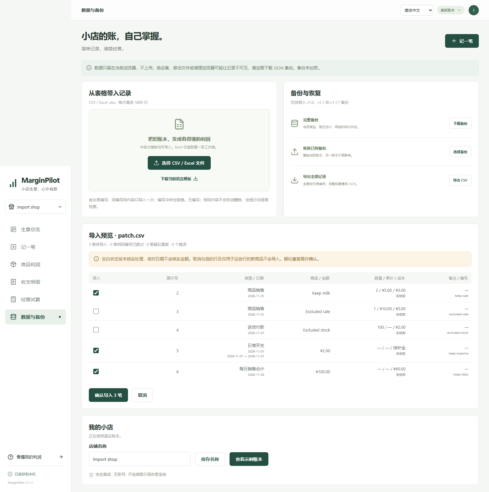

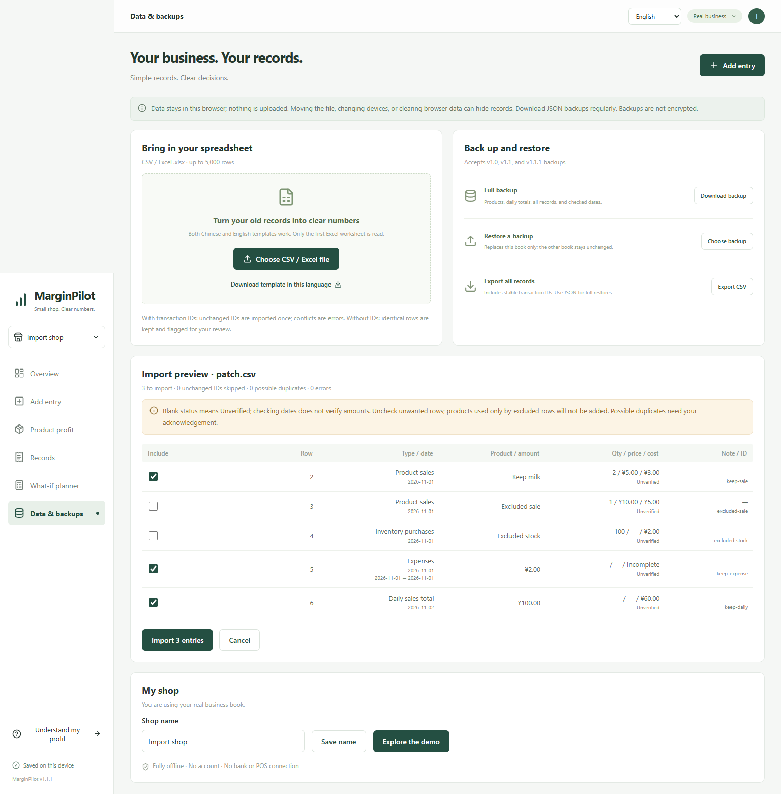

| 情况 | v1.1.1 的处理 |
|---|---|
| 内容相同，交易编号不同 | 两笔都保留 |
| 内容完全相同，没有编号 | 默认保留并提示检查，不会静默丢弃 |
| 编号相同，内容相同 | 显示已导入并跳过 |
| 编号相同，内容不同 | 报错；请修改原记录或使用新编号 |
| 一天多个合计，或合计与商品明细混记 | 报错，防止整天收入重复计算 |

编号在整个账本内唯一。内容比较包含备注、日期、金额、成本状态及费用覆盖范围。导出 CSV 会带稳定编号，原样再次导入可安全识别。原始文件**没有编号**时，重复导入不会自动抵消；请认真检查疑似重复，每个被勾选的行都会新增。仅备注不同不能证明是新交易。

| 中文列 | 英文列 | 用途 |
|---|---|---|
| 类型 / 日期 | Type / Date | 所有记录必填 |
| 商品 / 数量 / 单价 | Product / Quantity / Unit price | 商品销售；数量为正整数 |
| 单位成本 | Unit cost | 卖出或采购的单位成本；进货必填 |
| 金额 | Amount | 整笔费用，或当天销售收入 |
| 类别 | Category | 费用类别；内置类别支持两种语言 |
| 费用开始 / 费用结束 | Expense start / Expense end | 覆盖范围；不填时默认记录日期 |
| 状态 | Status | 未核实 / 已核实 / 估算，或 Unverified / Verified / Estimated；留空或没有此列时默认为未核实 |
| 备注 / 交易编号 | Note / Transaction ID | 可选的用户备注和稳定来源编号 |
| 卖出商品总成本 | Total sold cost | 只用于每日合计；留空表示缺失，不是零 |

限制：单次文件不超过 5 MB、5000 行；XLSX 解压不超过 20 MB；只读取第一张工作表；CSV 使用 UTF-8。支持 Excel 常见的 1900 日期系统数字日期。公式请先粘贴为值；旧 `.xls`、有密码的文件和 1904 日期系统不支持，会明确报错。文件只在本机解析，不执行公式或宏。CSV 导出带 UTF-8 BOM，并防护类似公式的文字。完整备份请使用 JSON，以保留记录身份、商品、用户文字和每日合计。

## 趋势、建议与试算

选择本月、上月或自选，最长查看 366 天。日图与紧邻之前的相同天数比较；月图显示截至所选结束日的六个自然月，最后一个月可能尚未结束。展开“查看图表数据与口径”可看精确数字。成本缺失会产生空缺；待核对日期显示零，不代表实际没做生意。

商品利润显示扣除房租人工前的贡献。建议会提示缺失或未核实成本、待核对日期、亏损商品及贡献较高的商品。

### 全店每月试算

1. 打开“经营试算 → 全店每月试算”，选择一个自然月。这里的月份控制全店试算；上方日期范围仍用于单个商品试算。
2. 填新的整月房租总额，留空则保留该月已分摊的房租。
3. 填采购成本变化百分比，范围 −100% 至 +100%。如 `-5` 表示便宜 5%。只调整已售商品的成本，包括每日合计；未售库存的进货付款不会另扣一次。
4. 填不含房租的整月其他开支新总额，留空保留原金额。明确填 `0` 表示试算时移除该项费用。
5. 比较原利润、试算利润和差额。点“恢复原来的数字”重置假设。

**成功标志：**结果即时变化，账本没有改变。例如月收入 10000 元、已售成本 6000 元、房租 1000 元、其他费用 500 元，原利润 2500 元。将房租改为 800 元、已售成本降低 10%、其他费用改为 400 元，得到 **3400 元**，比原来多 **900 元**。

基础数字是该自然月已录入的销售和分摊费用，**不会把几天销售自动推算成整月**。有未核对日期或不确定金额时会说明；缺成本时不显示完整试算利润。收入和销量保持不变，新费用总额替换原金额而不是额外再加。所有结果都是比较用的估计，不是预测或收益承诺。

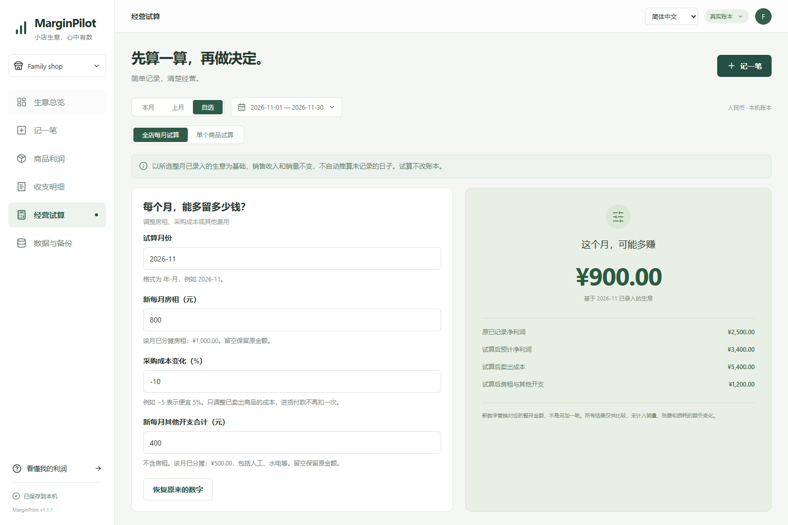

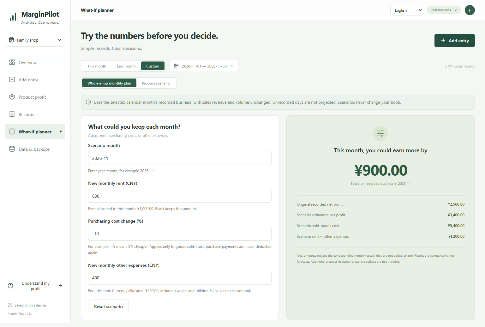

### 保留单个商品试算

选择“单个商品试算”，调整售价、单位成本和销量。其他开支保持不变，数量按整件取整；未改动的输入保留精确加权均值，原样试算影响为零。每日合计不参与商品排行或单个商品试算。

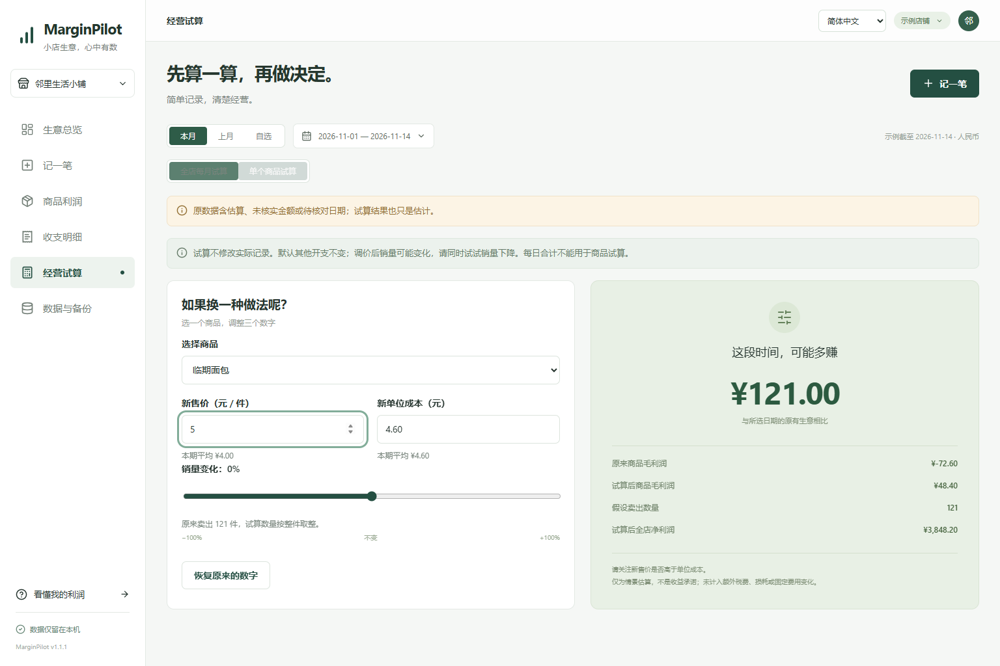

## 改错、备份与恢复

在明细点击铅笔修改，点击垃圾桶并确认后删除。删除、导入、恢复后的 15 秒内可撤销；另一笔保存会替换撤销状态。撤销恢复记录，但不会恢复已经失效的核对状态。

定期在“数据与备份”下载 JSON。备份不加密，请妥善保管。恢复只替换当前示例或真实账本，需要确认。保存失败时保留表单并显示错误，不会显示成功。检测到另一窗口修改账本时会阻止覆盖。原数据损坏时暂停写入并提供“导出原始数据”；通过明确的备份恢复可以修复账本。

浏览器存储不能代替备份。清理数据、隐私模式、更换浏览器或设备、移动 HTML 都可能使记录不可见。没有跨设备同步或多人记账服务器；请一次只在一个窗口编辑。

## 测试与开发

功能参考仍为 [Loyverse Back Office](https://loyverse.com/en-us/back-office) 的导航、日期筛选、趋势、商品报告和表格操作。MarginPilot 保持小店助手的范围，不扩展为 POS 或企业财务平台。

代码仍分为会计计算、导入、示例、表单、报告、图表、数据管理和应用外壳。v1.1 增加 `i18n.mjs` 的明确双语文案，以及 `storage.mjs`、`core.mjs` 中统一的保存和核对失效处理。没有新增运行时依赖、外部字体、联网请求或托管服务；单文件构建通过内容安全策略阻止网络连接。

验证包括 54 项会计、导入、存储和试算自动检查，以及中英文完整离线浏览器流程：首次选择、切换语言保留草稿、所有录入方式、日/月费用预设、图表、商品分析和试算、核对与重新核对、修改删除撤销、CSV/XLSX、编号冲突、无编号相同行、逐行排除、v1.0/v1.1/v1.1.1 备份恢复、导出、保存重开、无效输入、损坏数据恢复、模拟保存失败和多窗口冲突。本次补丁还检查空白/空格状态、已核实部分排除、零金额、排除行商品和共用商品、先记收入后补成本、自然月试算、无效假设和备份兼容。英文界面检查遗漏翻译，用户文字保持原样。已检查 1536×1024 桌面和 390×844 手机视图的截图、遮挡与溢出。

测试使用 Playwright 和已安装的 Chrome、Edge。本次会话没有 Browser 插件技能，之前的内置浏览器连接也曾超时。Windows 受限进程沙箱会取消下载，因此下载测试使用普通本地执行权限。测试使用隔离浏览器和虚构数据，不读写用户真实账本，也不关闭浏览器安全功能。未认证 Safari/Firefox、辅助技术、长期大型生产账本及实际报税流程。

以下命令仅给开发者，店主无需执行：`npm install`、`npm test`、`npm run build`、`npm run test:ui`、`node tests/edge-cases.mjs`、`node tests/v111-ui.mjs`、`node scripts/samples.mjs`、`npm run package`。开发需 Node.js 20+，设置 `BROWSER_CHANNEL=msedge` 可用 Edge 测试。下载包包含经过测试的独立 HTML、源码、双语说明、截图、导入示例及保留原文的第三方许可声明。

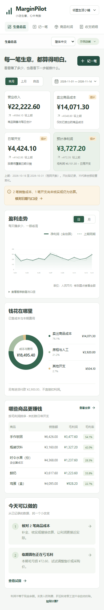
